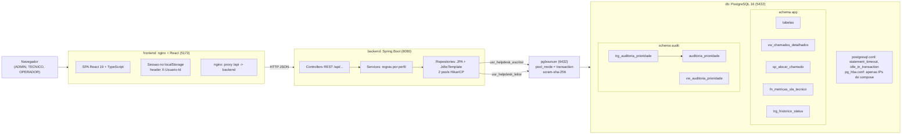
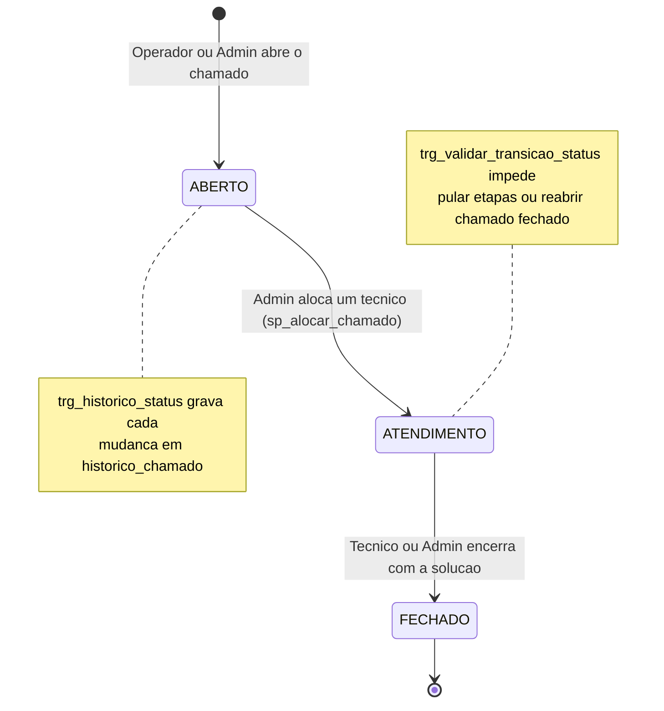
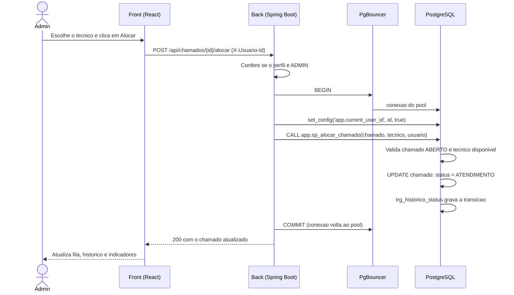
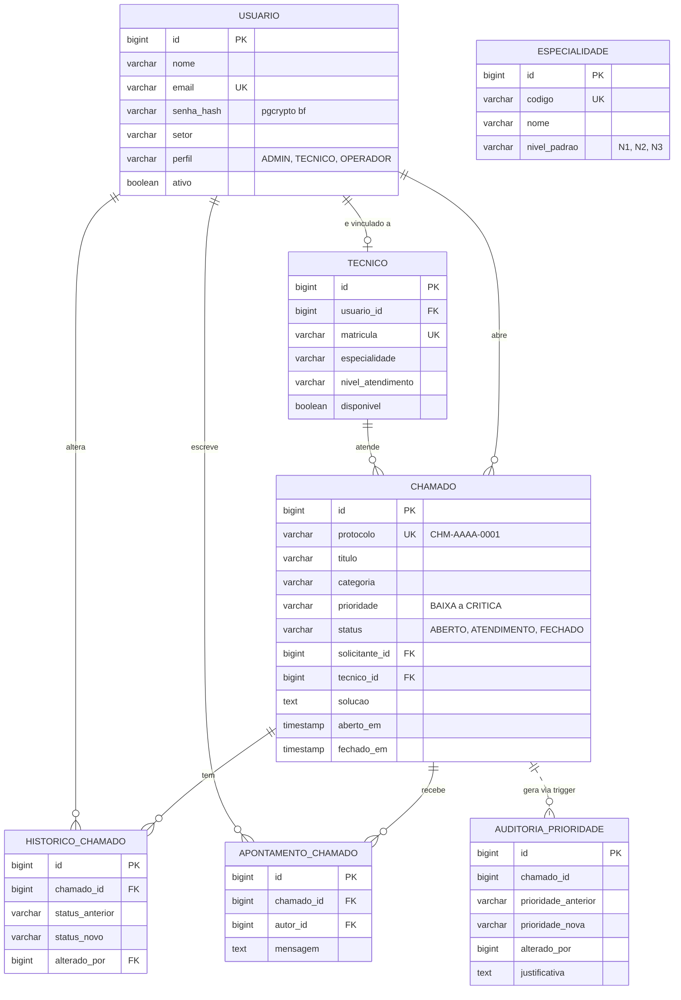

# Helpdesk TI

Sistema de controle de chamados de TI (Tema G3), desenvolvido para a disciplina de
Gerenciamento de Banco de Dados. O sistema permite abrir chamados, alocar técnicos,
acompanhar o histórico de atendimento e encerrar chamados, com as regras críticas
executadas no próprio PostgreSQL (triggers, procedure, function e views).

Toda a aplicação (banco, pool de conexões, API e interface) sobe com um único comando:

```bash
docker compose up --build
```

## Sumário

1. [Como executar](#1-como-executar)
2. [Credenciais de teste](#2-credenciais-de-teste)
3. [Serviços e portas](#3-serviços-e-portas)
4. [Estrutura do repositório](#4-estrutura-do-repositório)
5. [Arquitetura](#5-arquitetura)
6. [Banco de dados](#6-banco-de-dados)
7. [Requisitos da disciplina](#7-requisitos-da-disciplina)
8. [Como demonstrar os recursos do banco](#8-como-demonstrar-os-recursos-do-banco)
9. [API: principais endpoints](#9-api-principais-endpoints)
10. [Execução local sem Docker](#10-execução-local-sem-docker)
11. [Solução de problemas](#11-solução-de-problemas)
12. [Decisões de projeto](#12-decisões-de-projeto)

---

## 1. Como executar

Pré-requisito: Docker Desktop (ou Docker Engine com o plugin Compose) em execução.

```bash
git clone https://github.com/Guiba2077/helpdesk.git
cd helpdesk
docker compose up --build
```

Na primeira execução o Docker baixa as imagens, compila o backend (Maven) e o
frontend (Vite) e inicializa o banco com o script `bd/backup.sql`. Isso leva alguns
minutos. Quando o terminal mostrar `Started HelpdeskBackApplication`, acesse:

- Interface: http://localhost:5173
- Swagger da API: http://localhost:8080/swagger-ui.html

Para parar: `docker compose down`. Para recomeçar do zero, apagando o banco:
`docker compose down -v`.

## 2. Credenciais de teste

Os usuários são criados pelo `bd/backup.sql` na primeira inicialização. Não há
auto-cadastro nem recuperação de senha: o sistema é de uso interno.

| Perfil | E-mail | Senha | O que pode fazer |
|---|---|---|---|
| ADMIN | `admin@helpdesk.com` | `admin123@` | Tudo: cadastrar usuários, técnicos e especialidades, alocar técnicos, alterar prioridade, editar e inativar chamados |
| TECNICO | `maria.silva@helpdesk.com` | `tecnico123` | Registrar apontamentos e encerrar os chamados alocados a ela |
| TECNICO | `joao.souza@helpdesk.com` | `tecnico123` | Idem |
| OPERADOR | `carla.lima@helpdesk.com` | `operador123` | Abrir chamados, editar os próprios chamados e acompanhar o andamento |
| OPERADOR | `pedro.santos@helpdesk.com` | `operador123` | Idem |

Contas do banco (usadas pela aplicação, não pela interface):

| Conta | Role | Uso | Senha |
|---|---|---|---|
| `usr_helpdesk_escritor` | `rl_escritor` | Pool principal do backend (escrita) | `escritor123` |
| `usr_helpdesk_leitor` | `rl_leitor` | Pool de relatórios e auditoria (somente leitura, timeout de 3s) | `leitor123` |
| `postgres` | superusuário | Apenas pelo socket local do container (`docker compose exec db psql`) | `postgres123` |

## 3. Serviços e portas

| Serviço | Imagem | Porta no host | IP fixo na rede | Função |
|---|---|---|---|---|
| `frontend` | nginx 1.27 (build próprio) | 5173 | 172.28.0.40 | Serve a SPA e faz proxy de `/api` para o backend |
| `backend` | Temurin JRE 21 (build próprio) | 8080 | 172.28.0.30 | API REST Spring Boot |
| `pgbouncer` | edoburu/pgbouncer 1.23 | 6432 | 172.28.0.20 | Pool de conexões em modo transaction |
| `db` | postgres:16-alpine | 5432 | 172.28.0.10 | PostgreSQL 16 com configuração própria |

A rede `helpdesk_net` tem subnet fixa (172.28.0.0/24) porque o `pg_hba.conf` só aceita
conexões dos IPs do PgBouncer e do backend. A porta 5432 fica publicada de propósito:
uma tentativa de conexão a partir do host é rejeitada pelo próprio PostgreSQL, o que
demonstra o isolamento de rede.

## 4. Estrutura do repositório

```
helpdesk/
├── docker-compose.yml       Orquestra db, pgbouncer, backend e frontend
├── bd/
│   ├── backup.sql           DDL, roles, functions, procedure, triggers, views e seeds
│   ├── postgresql.conf      Timeouts, scram-sha-256, logs e memória
│   ├── pg_hba.conf          Regras de acesso por IP e método de autenticação
│   └── pgbouncer/
│       ├── pgbouncer.ini    Pool em modo transaction
│       └── userlist.txt     Credenciais que o PgBouncer aceita
├── helpdesk-back/           API REST em Spring Boot (Java 21)
│   ├── Dockerfile           Build multi-stage com Maven e JRE
│   └── src/main/java/.../  core (base genérica), business (módulos), config
└── helpdesk-front/          Interface web em React 19 + TypeScript + Tailwind
    ├── Dockerfile           Build com Node e entrega com nginx
    ├── nginx.conf           SPA fallback e proxy de /api
    └── src/                 api, auth, components, pages, util
```

A pasta de dados físicos do PostgreSQL fica em um volume gerenciado pelo Docker
(`helpdesk_pgdata`) e está no `.gitignore`. Ela nunca entra no repositório.

## 5. Arquitetura



### Ciclo de vida do chamado



### Fluxo de alocação de técnico



### Modelo do banco



## 6. Banco de dados

### Schemas

| Schema | Conteúdo |
|---|---|
| `app` | Tabelas operacionais, procedure, function, triggers de protocolo, transição e histórico, view de chamados |
| `audit` | Tabela e view de auditoria de prioridade, trigger de auditoria, trigger que bloqueia UPDATE e DELETE |
| `ext` | Extensões `pgcrypto` e `pg_stat_statements` (fora do `public`, que teve os privilégios revogados) |

### Roles e permissões

| Role / conta | Permissões |
|---|---|
| `rl_escritor` | SELECT, INSERT e UPDATE em `app`; SELECT em `audit`; EXECUTE nas rotinas de `app`. Sem DELETE (exclusão é lógica) e sem INSERT em `audit` |
| `rl_leitor` | SELECT em `app` e `audit`; EXECUTE apenas em `fn_metricas_sla_tecnico`. `default_transaction_read_only = on` e `statement_timeout = 3s` |
| `usr_helpdesk_escritor` | Login, membro de `rl_escritor`, limite de 20 conexões |
| `usr_helpdesk_leitor` | Login, membro de `rl_leitor`, limite de 15 conexões |
| `PUBLIC` | Perdeu CONNECT no banco, USAGE e CREATE no schema `public` e EXECUTE nas rotinas de `app` |

A auditoria é gravada por uma função `SECURITY DEFINER`: a conta da aplicação não
tem INSERT na tabela `audit.auditoria_prioridade`, mas a trigger consegue gravar.

### Objetos programáveis

| Tipo | Nome | Para que serve |
|---|---|---|
| Procedure | `app.sp_alocar_chamado(chamado, tecnico, usuario)` | Valida chamado ABERTO e técnico disponível, grava o técnico e muda o status para ATENDIMENTO |
| Function | `app.fn_metricas_sla_tecnico()` | Total de chamados, encerrados, em atendimento e tempo médio de resolução por técnico |
| Function | `app.fn_usuario_sessao()` | Lê o usuário logado da variável de sessão `app.current_user_id` |
| Trigger | `trg_gerar_protocolo` | Gera o protocolo `CHM-AAAA-0001` antes do INSERT |
| Trigger | `trg_validar_transicao_status` | Só permite ABERTO para ATENDIMENTO e ATENDIMENTO para FECHADO; exige técnico e solução |
| Trigger | `trg_historico_status` | Grava cada mudança de status em `historico_chamado` com o autor |
| Trigger | `trg_auditoria_prioridade` | Grava anterior, nova, autor e justificativa em `audit.auditoria_prioridade` |
| Trigger | `trg_auditoria_imutavel` | Bloqueia UPDATE e DELETE na auditoria |
| View | `app.vw_chamados_detalhados` | Chamado com nomes do solicitante e do técnico, horas em aberto e total de apontamentos |
| View | `audit.vw_auditoria_prioridade` | Auditoria com título do chamado e nome de quem alterou (lida pelo backend) |

### Variáveis de sessão

O backend executa, dentro de cada transação, `set_config('app.current_user_id', id, true)`
e `set_config('app.current_user_role', perfil, true)`. Ao alterar a prioridade, define
também `app.motivo_prioridade`. O terceiro parâmetro `true` limita o valor à transação,
o que é obrigatório com o PgBouncer em modo transaction.

### Configurações do servidor

| Arquivo | Parâmetro | Valor | Efeito |
|---|---|---|---|
| `postgresql.conf` | `statement_timeout` | 10s | Cancela qualquer comando longo (SQLSTATE 57014) |
| `backup.sql` (ALTER ROLE) | `statement_timeout` do leitor | 3s | Relatórios pesados são cancelados em 3s e a API responde HTTP 504 |
| `postgresql.conf` | `idle_in_transaction_session_timeout` | 30s | Derruba sessão que abriu transação e ficou ociosa |
| `postgresql.conf` | `lock_timeout` | 5s | Não espera mais de 5s por bloqueio |
| `postgresql.conf` | `password_encryption` | scram-sha-256 | Senhas gravadas em SCRAM |
| `postgresql.conf` | `log_statement` | mod | Todo INSERT, UPDATE, DELETE e DDL aparece em `docker compose logs db` |
| `postgresql.conf` | `shared_preload_libraries` | pg_stat_statements | Estatísticas de consultas para tuning |
| `pg_hba.conf` | método | scram-sha-256 | Apenas para 172.28.0.20 (PgBouncer) e 172.28.0.30 (backend); o resto é `reject` |
| `pgbouncer.ini` | `pool_mode` | transaction | Conexão física volta ao pool ao fim de cada transação |
| `pgbouncer.ini` | `default_pool_size` | 10 | Por par usuário e banco; o Postgres aceita 50 conexões no total |

## 7. Requisitos da disciplina

| Requisito | Onde está |
|---|---|
| Estruturação em schemas | `app`, `audit` e `ext` em `bd/backup.sql` |
| Roles e usuários (AAA/RBAC) | `rl_leitor`, `rl_escritor`, `usr_helpdesk_leitor`, `usr_helpdesk_escritor` |
| Pool de conexões (PgBouncer) | Serviço `pgbouncer` no compose, `bd/pgbouncer/pgbouncer.ini` |
| Timeouts no servidor | `statement_timeout` e `idle_in_transaction_session_timeout` em `bd/postgresql.conf` |
| Isolamento de rede e scram-sha-256 | `bd/pg_hba.conf` com IPs fixos da rede do compose |
| Prepared statements e hardening | JPA e JdbcTemplate com parâmetros em todas as consultas; `REVOKE ALL ON SCHEMA public` |
| Auditoria | `audit.auditoria_prioridade` alimentada por trigger, imutável |
| 1 Function, 1 Procedure, 1 Trigger, 2 Views | 2 functions, 1 procedure, 5 triggers e 2 views ativas |
| RLS ou pgcrypto | Senhas com `crypt()` e `gen_salt('bf')` do pgcrypto, validadas no SQL do login |

Especificidades do G3:

| Exigência | Como aparece |
|---|---|
| Trigger de histórico de status | Detalhe do chamado mostra a linha do tempo ABERTO, ATENDIMENTO, FECHADO com o responsável |
| `statement_timeout` curto | Tela SLA e tuning: botão de consulta pesada volta HTTP 504 em 3 segundos |
| Auditoria de prioridade | Tela Auditoria lista prioridade anterior e nova, quem alterou e a justificativa |

## 8. Como demonstrar os recursos do banco

Abra um `psql` dentro do container (o socket local é liberado no `pg_hba.conf`):

```bash
docker compose exec db psql -U postgres -d helpdesk
```

Timeouts em vigor para a conta de leitura:

```sql
SET ROLE usr_helpdesk_leitor;
SHOW statement_timeout;                     -- 3s
SELECT pg_sleep(5);                         -- ERROR: canceling statement due to statement timeout
RESET ROLE;
SHOW idle_in_transaction_session_timeout;   -- 30s
```

Transação abandonada derrubada pelo servidor (aguarde 30 segundos após o BEGIN):

```sql
BEGIN;
SELECT 1;
-- espere 30s e execute qualquer comando
SELECT 1;   -- FATAL: terminating connection due to idle-in-transaction timeout
```

Permissões (RBAC):

```sql
SET ROLE usr_helpdesk_leitor;
INSERT INTO app.chamado (titulo, descricao, categoria, solicitante_id) VALUES ('x', 'x', 'REDE', 1);
-- ERROR: cannot execute INSERT in a read-only transaction
CALL app.sp_alocar_chamado(4, 1, 1);
-- ERROR: permission denied for procedure sp_alocar_chamado
RESET ROLE;
SET ROLE usr_helpdesk_escritor;
DELETE FROM app.chamado WHERE id = 4;        -- ERROR: permission denied for table chamado
INSERT INTO audit.auditoria_prioridade (chamado_id, protocolo_chamado, prioridade_anterior, prioridade_nova)
VALUES (1, 'x', 'BAIXA', 'ALTA');            -- ERROR: permission denied for table auditoria_prioridade
RESET ROLE;
```

Triggers, procedure e views:

```sql
\d app.chamado                               -- lista as 4 triggers da tabela
\df app.*                                    -- functions e procedure
\dv app.*  \dv audit.*                       -- views

SELECT set_config('app.current_user_id', '1', false);
CALL app.sp_alocar_chamado(4, 1, 1);         -- ABERTO -> ATENDIMENTO
SELECT * FROM app.historico_chamado WHERE chamado_id = 4 ORDER BY id;

SELECT set_config('app.motivo_prioridade', 'Diretoria solicitou urgencia', false);
UPDATE app.chamado SET prioridade = 'CRITICA' WHERE id = 4;
SELECT * FROM audit.vw_auditoria_prioridade;

UPDATE audit.auditoria_prioridade SET justificativa = 'x' WHERE id = 1;
-- ERROR: Registros de auditoria sao imutaveis
SELECT * FROM app.fn_metricas_sla_tecnico();
SELECT protocolo, status, tecnico_nome, horas_em_aberto FROM app.vw_chamados_detalhados;
```

Isolamento de rede (a partir de outro container na mesma rede, com IP fora da lista):

```bash
docker run --rm -it --network helpdesk_helpdesk_net postgres:16-alpine \
  psql -h db -U usr_helpdesk_escritor -d helpdesk
# FATAL: no pg_hba.conf entry for host "172.28.0.x", user "usr_helpdesk_escritor" ...
```

PgBouncer:

```bash
docker compose exec pgbouncer psql -p 6432 -U usr_helpdesk_escritor pgbouncer -c "SHOW POOLS;"
```

Logs do servidor com os comandos de escrita (`log_statement = mod`):

```bash
docker compose logs -f db
```

## 9. API: principais endpoints

Base: `http://localhost:8080/api` (ou `http://localhost:5173/api` via nginx). Erros voltam
no formato `{ sucesso, mensagem, dados, erros }`.

| Método | Endpoint | Descrição |
|---|---|---|
| POST | `/auth/login` | Login com validação `pgcrypto` |
| GET, POST | `/usuarios` | Listar e cadastrar usuários (cadastro só ADMIN) |
| PUT | `/usuarios/{id}` | Editar usuário |
| PATCH | `/usuarios/{id}/status` | Ativar ou inativar usuário |
| GET, POST | `/tecnicos` | Listar e vincular técnicos |
| PATCH | `/tecnicos/{id}/disponibilidade` | Inverte a disponibilidade (ADMIN) |
| GET, POST | `/tecnicos/especialidades` | Listar e cadastrar especialidades |
| GET, POST | `/chamados` | Fila (filtrada por perfil) e abertura de chamado |
| GET | `/chamados/status/{status}` | Fila por status |
| GET | `/chamados/dashboard/resumo` | Indicadores |
| PUT, DELETE | `/chamados/{id}` | Editar e inativar chamado |
| POST | `/chamados/{id}/alocar` | Chama a procedure `sp_alocar_chamado` (ADMIN) |
| PATCH | `/chamados/{id}/prioridade` | Altera prioridade e dispara a auditoria (ADMIN) |
| POST | `/chamados/{id}/encerrar` | Encerra o chamado (TECNICO alocado ou ADMIN) |
| GET | `/chamados/{id}/historico` | Linha do tempo gravada pela trigger |
| GET, POST | `/chamados/{id}/apontamentos` | Notas técnicas |
| GET | `/auditoria/prioridades` | Trilha de auditoria (view `audit.vw_auditoria_prioridade`) |
| GET | `/relatorios/sla-tecnicos` | Function `fn_metricas_sla_tecnico` |
| GET | `/relatorios/pesado?segundos=6` | Consulta pesada cancelada pelo `statement_timeout` (HTTP 504) |

## 10. Execução local sem Docker

Útil para desenvolvimento. Requer Java 21, Maven, Node 20.19 ou superior e um
PostgreSQL 16 com o banco `helpdesk` criado e carregado:

```bash
psql -U postgres -c "CREATE DATABASE helpdesk"
psql -U postgres -d helpdesk -f bd/backup.sql

cd helpdesk-back && mvn -DskipTests spring-boot:run      # http://localhost:8080
cd helpdesk-front && npm install && npm run dev           # http://localhost:5173
```

Sem Docker o backend conecta direto em `localhost:5432`. Para outros valores use as
variáveis `DB_URL`, `DB_USER_ESCRITOR`, `DB_PASS_ESCRITOR`, `DB_URL_LEITURA`,
`DB_USER_LEITOR` e `DB_PASS_LEITOR`. No frontend, crie `helpdesk-front/.env` com
`VITE_API_URL=http://localhost:8080/api`.

## 11. Solução de problemas

| Sintoma | Causa provável | O que fazer |
|---|---|---|
| `backup.sql` não rodou e o banco está vazio | O volume já existia de uma execução anterior; o script só roda na primeira inicialização | `docker compose down -v` e suba de novo |
| Backend reinicia com `Connection refused` | PgBouncer ainda subindo | O serviço tem `restart: on-failure`; aguarde. Se persistir, veja `docker compose logs pgbouncer` |
| `no pg_hba.conf entry for host` nos logs do db | Algum serviço recebeu IP diferente do fixado no compose | Confira os `ipv4_address` e as linhas do `pg_hba.conf` |
| Login falha com credenciais corretas | Senha gravada sem pgcrypto ou `search_path` sem `ext` | Verifique `SHOW search_path` conectado como `usr_helpdesk_escritor` |
| Porta 5432, 5173, 6432 ou 8080 em uso | Outro serviço local na mesma porta | Pare o serviço local ou altere a porta do host no compose |
| Arquivos `.conf` ou `.ini` com erro de leitura no container | Quebra de linha CRLF | O `.gitattributes` força LF; rode `git add --renormalize .` |

## 12. Decisões de projeto

- Autenticação por header `X-Usuario-Id`, sem JWT: o sistema é interno, com usuários
  pré-cadastrados, e a prioridade do trabalho é a camada de banco. Sem o header, o backend
  assume o usuário 1 (admin).
- O backend valida perfis (ADMIN, TECNICO, OPERADOR) na camada de serviço e o banco
  valida as transições de status e a integridade por triggers, para que nenhuma regra
  crítica dependa só da aplicação.
- Exclusão é sempre lógica (`ativo = false`); por isso nenhuma role tem DELETE.
- A auditoria é imutável no banco: sem INSERT direto para a aplicação e com trigger que
  bloqueia UPDATE e DELETE.
- `DELETE /chamados/{id}` ainda não valida perfil no backend; o frontend só exibe o botão
  para ADMIN.
