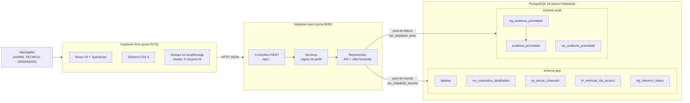
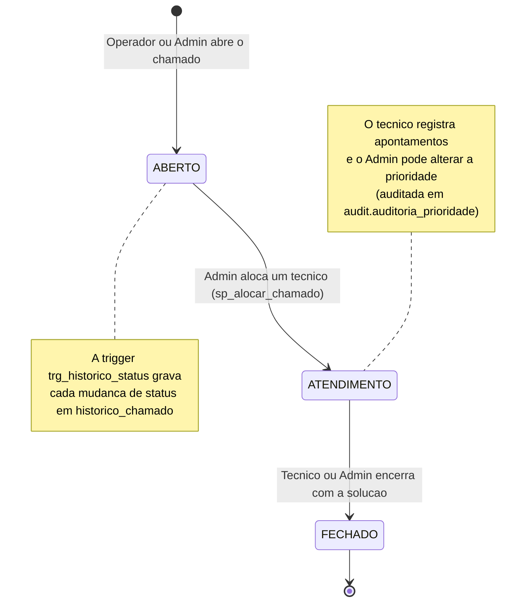
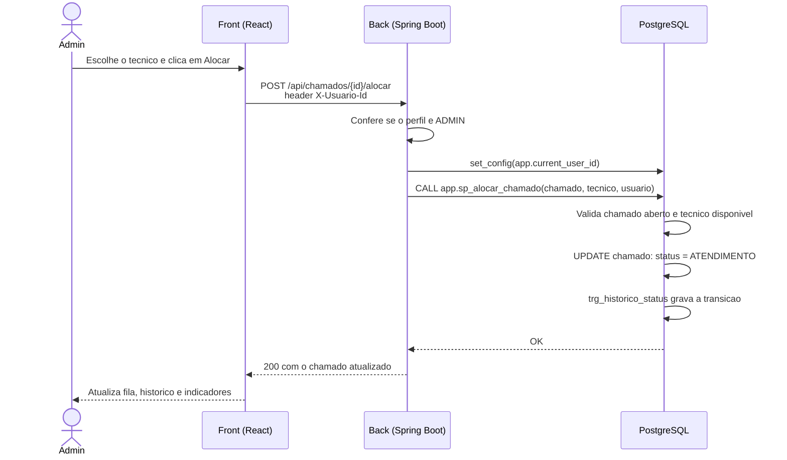
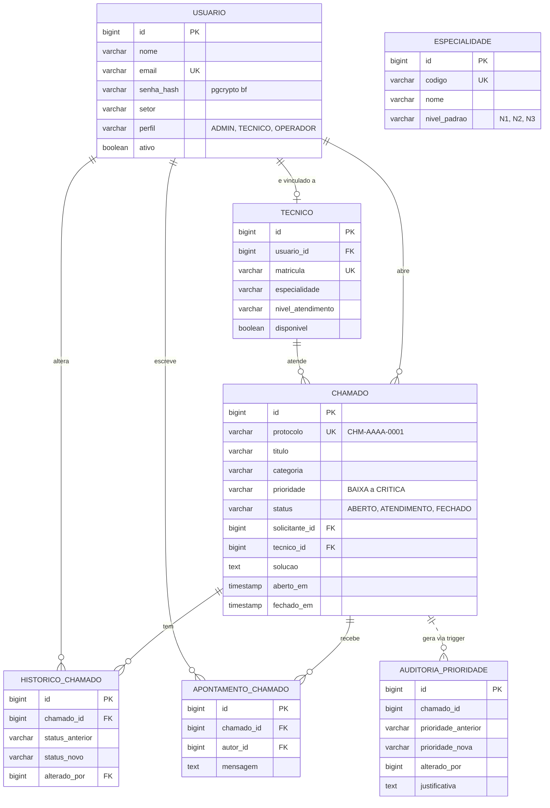

# Helpdesk TI

Sistema de controle de chamados de TI (Tema G3), desenvolvido para a disciplina de
Gerenciamento de Banco de Dados. O sistema permite abrir chamados, alocar técnicos,
acompanhar o histórico de atendimento e encerrar chamados, com regras importantes
executadas no próprio PostgreSQL.

## Sumário

1. [Escopo e divisão do trabalho](#1-escopo-e-divisão-do-trabalho)
2. [Estrutura do repositório](#2-estrutura-do-repositório)
3. [Diagramas](#3-diagramas)
4. [Tecnologias](#4-tecnologias)
5. [Requisitos](#5-requisitos)
6. [Banco de dados](#6-banco-de-dados)
7. [Como executar o back-end](#7-como-executar-o-back-end)
8. [Como executar o front-end](#8-como-executar-o-front-end)
9. [Acesso e perfis](#9-acesso-e-perfis)
10. [Telas do front-end](#10-telas-do-front-end)
11. [API: principais endpoints](#11-api-principais-endpoints)
12. [Requisitos da disciplina](#12-requisitos-da-disciplina)
13. [Pontos de atenção](#13-pontos-de-atenção)

---

## 1. Escopo e divisão do trabalho

| Parte | Pasta | Situação |
|---|---|---|
| Back-end (API REST) | `helpdesk-back/` | Neste repositório |
| Front-end (interface web) | `helpdesk-front/` | Neste repositório |
| Banco de dados (PostgreSQL) | fora deste repositório | Entregue pelo responsável pelo banco |

O repositório contém o front-end e o back-end. O script de criação do banco é
mantido pelo responsável pelo banco de dados e não faz parte deste repositório.

## 2. Estrutura do repositório

```
helpdesk/
├── helpdesk-back/     API REST em Spring Boot (Java 21)
│   ├── src/main/java/.../core/        Base genérica (controller, service, repositório, exceções)
│   ├── src/main/java/.../business/    Módulos: usuarios, tecnicos, chamados, auditoria, relatorios
│   ├── src/main/java/.../config/      Conexões, CORS, segurança e OpenAPI
│   └── README.md                      Documentação detalhada do back-end
└── helpdesk-front/    Interface web em React
    └── src/
        ├── api/           Cliente HTTP e chamadas à API
        ├── auth/          Sessão, contexto de login e rotas protegidas
        ├── components/    Layout, modais e componentes de formulário
        ├── pages/         Telas do sistema
        └── util/          Funções auxiliares
```

## 3. Diagramas

Os diagramas usam Mermaid, que o GitHub renderiza automaticamente.

### 3.1 Arquitetura do sistema



### 3.2 Ciclo de vida do chamado



### 3.3 Fluxo de alocacao de tecnico



### 3.4 Modelo do banco de dados



A tabela `especialidade` e consultada para preencher a lista de especialidades. O
campo `tecnico.especialidade` guarda o codigo dela como texto, sem chave estrangeira.

---

## 4. Tecnologias

**Back-end:** Java 21, Spring Boot 3, Spring Data JPA, JdbcTemplate, HikariCP,
PostgreSQL JDBC, Swagger (OpenAPI).

**Front-end:** React 19, TypeScript, Vite, Tailwind CSS 4, React Router.

**Banco de dados:** PostgreSQL 16 ou superior com a extensão `pgcrypto`.

## 5. Requisitos

- Java 21 e Maven
- Node.js 20.19 ou superior (testado com Node 24)
- PostgreSQL 16 ou superior, com o banco `helpdesk` já criado (seção 6)

## 6. Banco de dados

O back-end espera um banco chamado `helpdesk` em `localhost:5432`, com dois
schemas (`app` e `audit`) e as contas de conexão abaixo:

| Conta | Uso | Senha padrão |
|---|---|---|
| `usr_helpdesk_escritor` | Pool principal (escrita) | `escritor123` |
| `usr_helpdesk_leitor` | Pool de leitura (relatórios) | `leitor123` |

Se o seu banco usar outros valores, informe por variáveis de ambiente ao iniciar o
back-end: `DB_URL`, `DB_USER_ESCRITOR`, `DB_PASS_ESCRITOR`, `DB_URL_LEITURA`,
`DB_USER_LEITOR` e `DB_PASS_LEITOR`.

O banco precisa ter os objetos que o back-end consome:

| Objeto | Função |
|---|---|
| Tabelas em `app` | `usuario`, `especialidade`, `tecnico`, `chamado`, `historico_chamado`, `apontamento_chamado` |
| Tabela em `audit` | `auditoria_prioridade` |
| Procedure | `app.sp_alocar_chamado(chamado_id, tecnico_id, usuario_id)` |
| Function | `app.fn_metricas_sla_tecnico()` |
| Trigger de histórico | `trg_historico_status`, grava as mudanças de status |
| Trigger de auditoria | `trg_auditoria_prioridade`, grava as mudanças de prioridade |
| Views | `app.vw_chamados_detalhados` e `audit.vw_auditoria_prioridade` |
| Protocolo | Gerado pelo banco no formato `CHM-AAAA-0001` |
| Usuário inicial | `admin@helpdesk.com` com senha `admin123@`, guardada com `crypt` (pgcrypto) |

As triggers leem o usuário da sessão em `app.current_user_id` e a justificativa em
`app.motivo_prioridade`, valores que o back-end define a cada operação.

## 7. Como executar o back-end

```bash
cd helpdesk-back
mvn -DskipTests spring-boot:run
```

O `mvnw` do repositório não tem permissão de execução. Para usá-lo, rode antes
`chmod +x mvnw` e depois `./mvnw spring-boot:run`.

A API sobe em `http://localhost:8080`. A documentação interativa fica em
`http://localhost:8080/swagger-ui.html`.

Para gerar o pacote: `mvn clean package -DskipTests`.

## 8. Como executar o front-end

```bash
cd helpdesk-front
npm install
npm run dev
```

A interface sobe em `http://localhost:5173`. Por padrão ela fala com
`http://localhost:8080/api`. Para apontar para outro endereço, crie um arquivo
`.env` na pasta `helpdesk-front` com:

```
VITE_API_URL=http://localhost:8080/api
```

Para gerar a versão de produção: `npm run build`. Para checar o código: `npm run lint`.

## 9. Acesso e perfis

A autenticação usa o header `X-Usuario-Id`, e não JWT. No login, o front guarda os
dados do usuário no `localStorage` e envia o `id` em todas as requisições seguintes.
O login valida a senha direto no PostgreSQL, com `crypt()` do `pgcrypto`.

Conta inicial:

| Perfil | E-mail | Senha |
|---|---|---|
| ADMIN | `admin@helpdesk.com` | `admin123@` |

Os demais usuários são cadastrados pelo administrador em Administração, Usuários.

| Perfil | O que pode fazer |
|---|---|
| ADMIN | Tudo: cadastrar usuários, técnicos e especialidades, alocar técnicos, alterar prioridade, editar e inativar chamados |
| TECNICO | Registrar apontamentos, encerrar chamados e consultar a fila. Não abre chamados |
| OPERADOR | Abrir chamados, editar os próprios chamados e acompanhar o andamento |

## 10. Telas do front-end

| Tela | Rota | Quem acessa |
|---|---|---|
| Login | `/login` | Público |
| Chamados (fila, indicadores, filtros, abertura e detalhe) | `/chamados` | Todos |
| SLA e tuning (métricas por técnico e teste do timeout) | `/relatorios` | Todos |
| Auditoria de prioridades | `/auditoria` | Todos |
| Usuários | `/usuarios` | ADMIN |
| Técnicos | `/tecnicos` | ADMIN |
| Especialidades | `/especialidades` | ADMIN |

No detalhe do chamado ficam o histórico de status, os apontamentos técnicos, a
alocação de técnico, a alteração de prioridade com justificativa, o encerramento,
a edição e a inativação.

## 11. API: principais endpoints

Base: `http://localhost:8080/api`. Erros e permissões voltam no formato
`{ sucesso, mensagem, dados, erros }`.

| Método | Endpoint | Descrição |
|---|---|---|
| POST | `/auth/login` | Login com validação `pgcrypto` |
| GET, POST | `/usuarios` | Listar e cadastrar usuários (cadastro só ADMIN) |
| PUT | `/usuarios/{id}` | Editar usuário |
| PATCH | `/usuarios/{id}/status` | Ativar ou inativar usuário |
| GET, POST | `/tecnicos` | Listar e vincular técnicos |
| PATCH | `/tecnicos/{id}/disponibilidade` | Inverte a disponibilidade (ADMIN) |
| GET, POST | `/tecnicos/especialidades` | Listar e cadastrar especialidades |
| GET, POST | `/chamados` | Fila e abertura de chamado |
| GET | `/chamados/status/{status}` | Fila por status |
| GET | `/chamados/dashboard/resumo` | Indicadores |
| PUT, DELETE | `/chamados/{id}` | Editar e inativar chamado |
| POST | `/chamados/{id}/alocar` | Chama a stored procedure (ADMIN) |
| PATCH | `/chamados/{id}/prioridade` | Altera prioridade e dispara a auditoria (ADMIN) |
| POST | `/chamados/{id}/encerrar` | Encerra o chamado |
| GET | `/chamados/{id}/historico` | Linha do tempo gravada pela trigger |
| GET, POST | `/chamados/{id}/apontamentos` | Notas técnicas |
| GET | `/auditoria/prioridades` | Trilha de auditoria |
| GET | `/relatorios/sla-tecnicos` | Function de SLA |
| GET | `/relatorios/pesado?segundos=6` | Consulta pesada, cancelada pelo `statement_timeout` (HTTP 504) |

## 12. Requisitos da disciplina

**CRUD:** abertura de chamados, alocação de técnicos, histórico de atendimento e
encerramento.

**Especificidades do banco de dados:**

| Requisito | Como aparece no sistema |
|---|---|
| Trigger de histórico (Aberto, Atendimento, Fechado) | A linha do tempo no detalhe do chamado mostra cada mudança, com o responsável |
| `statement_timeout` curto contra relatórios pesados | A tela SLA e tuning executa uma consulta de 6 segundos. O banco cancela aos 3 segundos e a tela mostra o aviso de HTTP 504 |
| Auditoria das alterações de prioridade | A tela Auditoria lista prioridade anterior e nova, quem alterou e a justificativa |

## 13. Pontos de atenção

- A autenticação por `X-Usuario-Id` é uma decisão do projeto para a demonstração. Se o
  header não for enviado, o back-end assume o usuário de id 1.
- `DELETE /chamados/{id}` ainda não valida o perfil no back-end. O front só exibe o
  botão de inativar para o ADMIN.
- Ao cadastrar uma especialidade com código repetido, o back-end devolve a mensagem
  de erro do banco sem tratamento amigável.
- O `statement_timeout` depende de como o banco foi configurado: se estiver aplicado
  apenas às contas da aplicação, o cancelamento só ocorre nas conexões feitas por elas.
